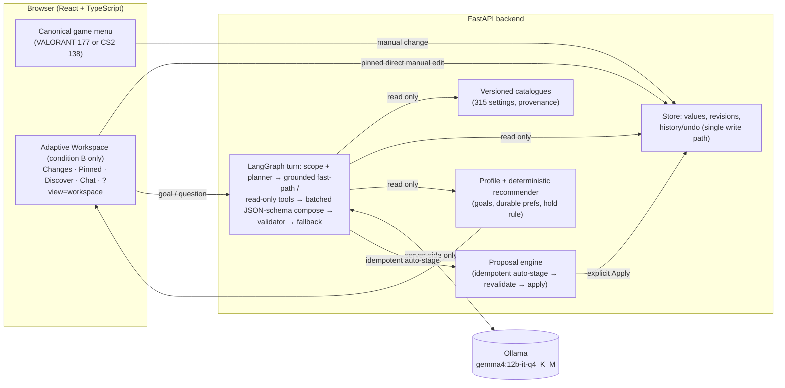

# Implementation notes for the paper (verified facts only)

*Adapting Without Rearranging: Conversational Guidance for Complex Settings* — CSC2524, University of Toronto.
Everything below was implemented and verified across the initial Windows prototype (2026-11-21) and the macOS comprehensive UX, settings, and optimization pass on branch `feat/comprehensive-ux-settings-pass` (2026-11-22). **No human-participant study has been conducted**; no participant data exists. Reported numbers come from automated test suites and logged local `gemma4:12b-it-q4_K_M` runs.

## System overview

* **Testbed:** two simulated PC settings menus (**315 settings total** in catalogue `2026.11.22-1`).
  * **VALORANT (177 settings, 59 AI-proposable):** `24` `verified-official-doc`, `32` `verified-official-screenshot`, `28` `partially-verified`, `93` `secondary-only`; `157` `verified` / `19` `inferred` / `1` `partial` menu paths; `43` sliders marked `rangeVerified: false`. Includes a simulated **15-profile Crosshair editor** (`General`, `Primary`, `Aim Down Sights`, `Sniper Scope`), reactive SVG preview, custom `#RRGGBB` color domain, and validated Riot `0;P;...` share-code import/export (`backend/app/domain/crosshair.py`), plus simulated *Video > Stats*, *Audio > Voice-Over*, and *Controls > Actions / Equipment / Communication*.
  * **Counter-Strike 2 (138 settings, 93 AI-proposable):** all `138` entries `verified-game-files` (`0` inferred paths, `0` unverified slider ranges) extracted from CS2 client files of build `2000948` (`SteamDatabase/GameTracking-CS2 @ 694f81f`), including explicit-apply *Advanced Video* presets, **HUD Edge Positions** (`safezonex`/`safezoney`) with Valve's `(1-Y)*50% / (1-X)*50%` safezone preview and immediate *Done* commit (`HudEdgeX` fixed `0.50` prototype floor), and a curated simulated *New* tab.
* **Conditions:** **A (Baseline)** provides static canonical navigation, prototype search, manual edits, Crosshair/HUD Edge editors, and undo history. **B (Adaptive)** keeps the identical canonical rows and manual behavior while adding Participant-mode chat (auto-staged changes), `Changes` / `Pinned` / `Discover` Adaptive Workspace, AI locks, detachable `/?view=workspace` sync, and hidden **Experimenter** diagnostics. Automated tests assert strict A/B DOM row parity and zero AI affordances in A.

## Comprehensive Pass Extensions & Literature Grounding (2026-11-22)

See [NEXT_PASS_DESIGN_AUDIT.md](NEXT_PASS_DESIGN_AUDIT.md), [RESEARCH_RATIONALE.md](RESEARCH_RATIONALE.md), [REQUIREMENTS_MATRIX.md](REQUIREMENTS_MATRIX.md), and [PARTICIPANT_PILOT.md](PARTICIPANT_PILOT.md):

1. **Literature Synthesis (7 verified HCI papers):** Findlater & McGrenere (CHI 2004, IJHCS 2010), Bunt et al. (IUI 2007), Todi et al. (CHI 2021), Kim et al. (IUI 2026), Alves et al. (CHI 2026), and **Ingesson & Riveiro (DIS 2026)** (*When Do Users (Not) Want Explanations?* — note selective, goal-dependent explanation demand and the empirical requirement to evaluate comprehension independently of passive explanation availability).
2. **Intent-Adaptive Scope & Coverage Planning:** `backend/app/agent/scope.py` classifies requests across five scopes (`explain_only`, `focused`, `category_optimization`, `broad_optimization`, `full_game_setup`), respecting `explain_only` precedence even under explicit UI scope overrides. `backend/app/domain/planner.py` (`build_coverage_audit`) evaluates the entire game catalogue against active goal weights, locks, staged items, availability rules, and minor/secondary confidence suppression before LLM invocation (`MAX_PROPOSAL_ITEMS=60`), yielding zero forced changes on already-aligned states (`well_configured_competitive`).
3. **Auto-Staging Without Auto-Application:** Whenever an assistant turn produces valid recommendations outside `explain_only`, `runner.py` -> `proposals.auto_stage_for_run` stages one proposal idempotently inside the database write transaction (enforced by unique partial index `idx_proposals_run_autostage`). Zero active setting values change prior to explicit user **Apply selected changes**.
4. **Adaptive Workspace & Detachable View:** `AdaptiveWorkspace.tsx` unifies `Changes` (category-grouped diffs with inline editing and trade-offs), `Pinned` (direct manual `SettingControl` edits honoring user authority over AI locks + CS2 unapplied Video draft guard), and `Discover` (held proactive/cross-game cards staged only on explicit **Prepare for review**), synchronized with standalone `/?view=workspace` via `BroadcastChannel` and `storage` events (`sync.ts`).
5. **Participant vs. Experimenter Presentation:** `StudyBar.tsx` hides A/B condition pills, `Study controls`, `Trace`, and raw model IDs behind an explicit `Experimenter` toggle; Participant chat surfaces safe progress labels (`participantStepLabel`), a compact `Review N changes` button, and collapsed `What I checked` summaries.

## Design goals → mechanisms (current verified state)

| Goal | Mechanism (implemented) |
|---|---|
| **DG1 Stable access** | Canonical catalogue order is invariant across A and B; recommendations link directly to canonical menu rows (`Show in settings` with highlight); `Pinned` provides user-curated shortcuts/manual controls without reordering the menu; search jumps to canonical locations. |
| **DG2 Understanding** | Every recommendation card and explanation separates **What it does** (catalogue semantics, source-labelled) from **Why this may help your goal** (model or rule rationale, origin-labelled), trade-offs, and collapsed `What I checked` coverage facts. Validator strips URLs and unverifiable numeric performance claims (`%`, `FPS`, `ms`). |
| **DG3 Agency** | Explicit change requests auto-stage safely into `Workspace → Changes` (never modifying active settings until **Apply selected changes**); Discover suggestions require explicit **Prepare for review**; users can edit values inline, reject with reason, lock settings from AI while retaining manual/Pinned authority, switch off adaptation, and revert batches atomically via **Undo**. |
| **DG4 Continuity & context** | Transient session goals stay scoped per game/session, while durable preferences are saved only on explicit confirmation (`PreferenceChip` / panel) and transfer **only as abstract dimensions** across games (e.g., citing `"your saved preference … in VALORANT"` in CS2); mouse sensitivity, keybinds, presets, colors, and unverified sliders remain non-AI-proposable. |

## Authority boundary (the safety property)

* The model has **no write tools**. Available read-only tools are `get_current_ui_state`, `list_settings`, `get_setting_details`, `search_settings`, `get_user_preferences`, and `get_change_history`.
* Structured model output (`AssistantDraft` / `BatchDraft`) is validated server-side (`validate_draft`) against the selected game's allowlist, `aiProposable` flag, locks, strict option/numeric domain bounds, hardware/dependency availability, no-ops, already-staged exclusions, and duplicates; foreign-game IDs and labels are rejected.
* Apply executes atomically in a SQLite `BEGIN IMMEDIATE` transaction with per-setting revision checks and idempotency keys (`Conflict 409` on stale revisions or post-stage locks; all-or-nothing rollback on failure). Automated tests verify 4 concurrent apply requests yield at most 1 commit, post-staging locks block the entire bundle cleanly, and prompt-injection attempts alter zero settings.

## Measured local-model & test performance (automated; not user outcomes)

* **Cross-platform verification:** Tested on both the original **Windows 11 + RTX 4080 SUPER** baseline (`62/62` pytest, `10/10` vitest, `12/12` E2E, Windows Gemma 4 median `5.0 s` on narrow single-batch turns before the comprehensive pass) and **macOS `Darwin 27.0.0` `arm64` (Apple M4, 24 GB)** for the comprehensive pass (**102** backend `pytest`, **17** `vitest`, clean `tsc`/`vite` build, **17** Playwright E2E specs, `8/8` real-model `smoke_check.py`). See [TEST_SUMMARY.md](TEST_SUMMARY.md) for full run breakdowns.
* **Local `gemma4:12b-it-q4_K_M` macOS optimization (`20261122-143214` before vs. `20261122-164946` after):**
  By adding grounded fast-path routing (`AGENT_FAST_PATH=true` skipping redundant tool-planning calls when deterministic catalogue search/coverage already grounds the turn), fixing the post-tool-limit extra `plan` edge, eliminating full-catalogue JSON duplication (`~867–1,936` compose input tokens instead of `3,507–7,614`), lowering `OLLAMA_NUM_CTX` from `16384` to `8192`, packing category batches up to `BATCH_SIZE=12` with a compact `BatchDraft` secondary schema, and fixing stopword/substring matching in `search_settings`:
  * **Narrow / explain / preference / single-setting turns (`explain_aa`, `focused_vsync`, follow-ups):** dropped from `133.6–182.8 s` to **`18.6–31.9 s`** (**4.6×–9.8× faster**; `focused_vsync` now accurately proposes and auto-stages `VSync: On → Off` in `31.9 s`).
  * **Category optimization (`perf_goal` t1, 12 VALORANT Video settings):** dropped from `283.8 s` to **`74.5 s`** (**3.8× faster**, `0` filtered).
  * **Comprehensive multi-category setup (`cs2_full_setup`, 21 CS2 candidates across Video/Audio/Game):** improved from **`360.1 s` deadline timeout (fallback)** to **`136.0 s` real AI (`source="ai"`)**, staging **`18` validated settings across Video, Audio, and Game** (`0` filtered, `valuesUnchanged=True`).
  * **Well-configured state restraint (`well_configured`):** dropped from `228.1 s` (previously forcing 1 extra tweak) to **`45.4 s`** with **`0` forced recommendations**.
  * **6-case evaluation total:** **`381.9 s`** vs **`1,628.9 s`** baseline (**4.3× overall speedup**), `8/8` real AI turns succeeded without unexpected fallback.

## Limitations (state honestly in the paper)

* **Simulation only:** No game config files are read or modified, and no real FPS, GPU frame time, or input latency is measured. PC specs and context events are synthetic fixtures.
* **VALORANT catalogue provenance:** VALORANT lacks public client UI files; `93` settings rely on dated secondary sources, `43` sliders lack officially published min/max bounds (`rangeVerified: false`, ≈ badge, non-AI-proposable), `19` post-12.07 placements are inferred (ⓘ), and Riot share-code import/export omits unmodeled metadata tokens safely rather than faking support. CS2 `HudEdgeX` uses a `0.50` fixed prototype minimum floor.
* **Hardware latency bounds on Apple M4 laptop inference:** While `gemma4:12b-it-q4_K_M` (`11.9B Q4_K_M`) is now practically usable on Apple M4 (`18.6–31.9 s` interactive narrow turns; `~74.5 s` category setup), full-game multi-category synthesis (`~136.0 s`) remains slower than real-time chat expectations; pilot sessions should pre-warm Ollama, surface progress feedback, or run on a faster GPU (e.g., RTX 4080 SUPER) when high turn volume is required.
* **Stochastic model variance & offline rules:** Local LLM outputs vary across runs (bounded but not eliminated by `validate_draft` and 1 repair round); `Discover` ranking uses transparent deterministic rules rather than learned personalization across arbitrary dimensions.
* **Zero human participants tested:** Track B comprehension, trust, rubber-stamping frequency, and docked-vs-detached workspace preference remain empirical hypotheses under [PARTICIPANT_PILOT.md](PARTICIPANT_PILOT.md), not findings.
