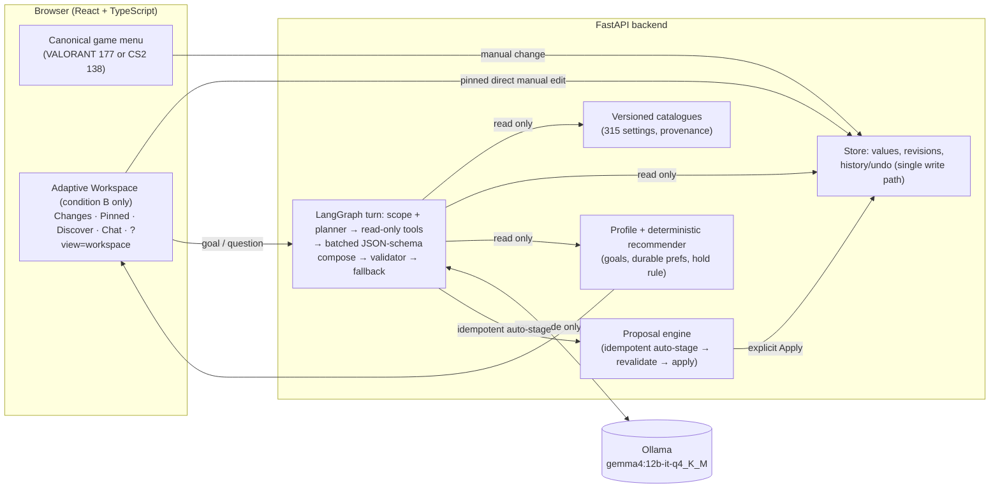

# Implementation notes for the paper (verified facts only)

*Adapting Without Rearranging: Conversational Guidance for Complex Settings* — CSC2524, University of Toronto.
Everything below was implemented and verified across the original Windows prototype (2026-11-21) and the macOS
comprehensive UX & settings pass (2026-11-22). **No human-participant study has been conducted**; no participant
data exists. Numbers come from automated suites and logged local `gemma4:12b-it-q4_K_M` runs.

## System overview

* **Testbed:** two simulated PC settings menus (**315 settings total** in catalogue `2026.11.22-1`). VALORANT: **177 settings** (24 `verified-official-doc`, 32 `verified-official-screenshot`, 28 `partially-verified`, 93 `secondary-only`, plus 15-profile Crosshair editor with reactive SVG preview & Riot `0;P;...` code import/export); CS2: **138 settings** extracted from the CS2 client files of build `2000948` (`SteamDatabase/GameTracking-CS2 @ 694f81f`, incl. HUD Edge Positions `safezonex`/`safezoney` preview with immediate *Done* save and simulated *New* tab). Both menus share one typed settings engine and differ in layout and styling.
* **Conditions:** A = static baseline (full menu, manual change, prototype search, history/undo). B = the same menu plus Participant-mode Adaptive UX (`Changes` / `Pinned` / `Discover` Adaptive Workspace, detachable `/?view=workspace`, simplified chat w/ auto-staged proposals, pins/locks, and Experimenter drawer hidden behind an explicit toggle). Automated tests assert identical rows and order in A and B and zero AI affordances in A.

## Comprehensive Pass Extensions & Literature Grounding (2026-11-22)

See [NEXT_PASS_DESIGN_AUDIT.md](NEXT_PASS_DESIGN_AUDIT.md), [RESEARCH_RATIONALE.md](RESEARCH_RATIONALE.md), and [PARTICIPANT_PILOT.md](PARTICIPANT_PILOT.md) for the detailed pass record:

1. **Literature Synthesis (7 verified HCI papers):** Findlater & McGrenere (CHI 2004, IJHCS 2010), Bunt et al. (IUI 2007), Todi et al. (CHI 2021), Kim et al. (IUI 2026), Alves et al. (CHI 2026), and **Ingesson & Riveiro (DIS 2026)** (*When Do Users (Not) Want Explanations?* — corrected verified second author spelling; note that explanation demand is selective/goal-driven and passive explanations alone do not guarantee comprehension or calibration).
2. **Intent-Adaptive Scope & Idempotent Auto-Staging:** `backend/app/agent/scope.py` and `backend/app/domain/planner.py` adapt candidate scope (`explain_only`, `single_setting`, `focused_goal`, `broad_setup`, `full_setup`) and perform per-category batching (`MAX_PROPOSAL_ITEMS=60`), while `proposals.auto_stage_for_run` stages validated plans idempotently (`idx_proposals_run_autostage`) without modifying any active value until explicit user Apply.
3. **Adaptive Workspace, Pinned Direct Edits & Sync:** `AdaptiveWorkspace.tsx` unifies `Changes` (category-grouped diffs), `Pinned` (direct manual `SettingControl` edits honoring user authority over AI locks + CS2 pending Video conflict guard), and `Discover` (held proactive cards), synchronized with `/?view=workspace` over `BroadcastChannel` (`sync.ts`).
4. **Participant vs. Experimenter Presentation:** `StudyBar.tsx` hides A/B tags, `Study controls`, `Trace`, and raw model IDs behind an explicit `Experimenter` toggle; chat replies collapse `What I checked` details by default.
5. **Notable Deviations from Initial Spec & Rationale:** Prompt context uses deterministic pre-filtering (`render_plan_context` + candidate-scoped `render_context`) instead of sending the entire 315-setting JSON to local 12B inference on macOS (cutting multi-category prompt overhead while preserving read-only tool calls and server-side validation); CS2 `HudEdgeX` uses a `0.50` documented floor approximating `OptionsMenuAPI.GetHudSafeZoneXMin()`.

## Automated checks vs. human claims boundary

Track A (technical verification on macOS arm64 + Windows baseline) confirms A/B parity, zero unapproved setting writes, lock/keybind/sensitivity safety boundaries, Riot crosshair & CS2 safezone math, and schema-valid local `gemma4:12b-it-q4_K_M` responses (see [TEST_SUMMARY.md](TEST_SUMMARY.md)). **Track B (human evaluation) has not been executed**; the protocol in [PARTICIPANT_PILOT.md](PARTICIPANT_PILOT.md) measures independent post-task comprehension separately from viewing chat explanations.

## Design goals → mechanisms

| Goal | Mechanism (implemented) |
|---|---|
| **DG1 Stable access** | Canonical catalogue order is never changed; recommendations link to the *existing* row (temporary outline highlight); pins are shortcuts, not copies; search jumps to the canonical location. |
| **DG2 Understanding** | Every card separates **What it does** (verified catalogue text, source-labelled: Valve tooltip / Riot doc / editorial) from **Why this may help your goal** (model or rule rationale, origin-labelled), plus trade-offs, verification level and a *Why this?* evidence panel. Unverifiable numeric performance claims are removed by the validator. |
| **DG3 Agency** | Suggestions → explicit **Stage** → editable review tray → **Apply selected changes**; reject/dismiss with feedback; locks (“Locked from AI changes”) enforced at staging and apply; history with source, before/after and proposal id; undo; adaptation can be switched off. |
| **DG4 Continuity & context** | Session goals (transient, per game) vs durable preferences (explicit, cross-game, with evidence); simulated context events (labelled); cross-game transfer of *abstract* preferences only — CS2 suggestions cite “your saved preference … in VALORANT”; sensitivity and keybinds are never proposable. |

## Authority boundary (the safety property)

* The model has **no write tools**. Read-only tools: `get_current_ui_state`, `list_settings`, `get_setting_details`,
  `search_settings`, `get_user_preferences`, `get_change_history`.
* Its structured answer is validated against the selected game's allowlist, proposability, locks, value domain (exact
  options / on-grid numbers), availability on the simulated PC, no-ops and duplicates; IDs or labels from the other game
  are rejected. Baselines are captured server-side when the user stages.
* Apply is all-or-nothing in one SQLite `BEGIN IMMEDIATE` transaction with per-setting revision checks and idempotency
  keys; conflicts return 409 with per-item reasons. Tests: 4 simultaneous applies → exactly 1 succeeds; a bundle with
  one item locked after staging applies nothing; a prompt-injection request changes nothing.

## Measured results (automated; not user outcomes)

* Tests: backend **62/62**, frontend unit **10/10**, Playwright end-to-end **12/12** (5 consecutive runs), smoke
  check 9/9.
* Real local model (`gemma4:12b-it-q4_K_M`, RTX 4080 SUPER 16 GB, think off), 10 goal cases / 13 turns: 12 turns
  answered by the model with the intended intent (recommend / explain / preference / navigate / clarify), 1 deliberate
  model-failure turn answered by the labelled fallback; latency **3.1–8.0 s (median 5.0 s)** per turn after warm-up
  (cold load ≈ 20 s); 12/12 schema-valid answers; the assistant changed **0** values and auto-created **0** proposals.
* Reasoning mode on: median 13.2 s and one answer failed to complete valid JSON within 6 000 tokens → kept off.
* Prompt iteration with the real model was necessary: the first version produced clarifying questions instead of
  recommendations for clear goals (logged in `docs/evidence/model_runs/`).

## Limitations (state them in the paper)

* Simulation only: no game files are read or written; no frame-rate or latency effect is measured. Suggestions are
  grounded in documentation, not in measurements of the user's PC (the PC profile is simulated).
* VALORANT has no public machine-readable settings source; 14 settings rely on secondary sources and 19 section
  placements after Patch 12.07 are inferred. The VALORANT crosshair editor is not simulated.
* One model on one Windows PC; macOS instructions are untested. Model outputs vary between runs; the validator and
  the single repair round bound, but do not eliminate, this variability.
* Relevant-now ranking is a transparent rule (goal tags × weights), not learned; cross-game transfer is limited to the
  nine abstract preference dimensions encoded in the catalogues.
* No participants: claims about comprehension, usability or trust are **not** established by this work.

## Proposed first human evaluation (not conducted)

Within-subjects comparison of A vs B on the same game, catalogue and starting state: participants complete
goal-based tasks involving unfamiliar settings (e.g. “reduce input latency”, “see players better in dark areas”).
Primary measure: **independent understanding** of the changed settings (post-task explanation of function and
trade-off, scored blind). Secondary: task success and time, number of unintended changes, use and acceptance of
undo/lock/reject, perceived control and trust (questionnaires), and transfer to the second game. The current build
already logs the needed traces (history sources, proposal decisions, run traces, dismissals with reasons).
