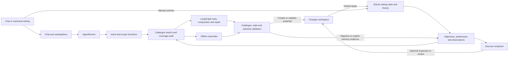

# Architecture audit

Baseline commit `c75d81e2e726fd14e26a3f31e6961f925cb097f4`. Findings below point to the stable function names in the baseline or candidate. [Comparative evidence](EVALUATION_RESULTS.md) gives the fixture and observed outcome.

## How a turn reaches the settings menu

- `backend/app/api/routes.py` checks condition, exposes catalogue and simulation state, dispatches chat and posts manual edits, Apply, Undo and restage. `AgentRunner.start` owns one active run per game. It records the user turn and hands work to `_execute`. `AgentRunner._finish` records results and may update profile evidence and stage a draft in a transaction. Experimenter traces and participant-facing Chat carry different detail.
- `classify`, `detect_dimensions`, `classify_scope` and `build_coverage_audit` independently set intent, scope, retrieval weights and eligible candidates. `search_settings` uses lexical/token matches against ID, label, path, descriptions and goal tags. `build_turn_graph.prepare` merges search and coverage IDs, then chooses a tool-planning call for uncertain retrieval, history or an explicitly unoptimized run. Tools read current values, settings, preferences, history and cross-game analogues. `compose` can split broad cases into multiple bounded calls. `validate` enforces invariants and can ask for one repair. Failed inference uses `fallback_turn`.
- `validate_draft` resolves setting IDs or exact labels, normalizes values, checks game, lock, proposability, availability, pending items, no-ops and output caps. `ProposalService.auto_stage_for_run` rechecks and deduplicates transactional proposals. `ProposalService.apply` and `Store._apply_tx` validate changes again and record history with pre/post values. `undo_batch` checks safety against intervening state. `restage_from_batch` builds a new draft against current values and retains provenance without committing. Source labels distinguish manual, model, rules and fallback paths.
- `frontend/src/adaptive/Chat.tsx` renders the answer, matched explanation and navigation. `AdaptiveWorkspace.tsx` coordinates Changes, Pinned and Discover. `RecommendationCard.tsx` renders effect, rationale and trade-off. `useAppStore.ts` owns API state and refreshes relevant views. `StandaloneWorkspace.tsx` and `lib/sync.ts` use cross-window messages and a detached lease. The canonical games and category locations do not consume adaptive ordering.

## Discover path

`Store.manual_change` and Apply/Undo leave committed batch events. The API and the end of a chat run can refresh `RelevantNowService`. On game entry, the service calls `ensure_first_visit`. `_collect_candidates` merges context, companion rules, onboarding and weighted goals, deduplicates setting IDs and writes a snapshot. `get` reconciles snapshot items with live state and computes update availability. `dismiss` records feedback separately from durable preferences. `RelevantNow.tsx` shows live status and can route to a setting or stage a candidate. [Details and ablations](DISCOVER_AUDIT.md)

## Prioritized findings

| Severity and goals | Baseline cause | Evidence and consequence | Candidate response |
| --- | --- | --- | --- |
| High, DG3–DG4 | `validate_draft` validates capability and values without interpreting explicit no-change constraints. The planner counts excluded controls when selecting candidates. | B2 staged and applied three excluded audio settings. Held-out VSync and shadow exclusions also failed after explicit Apply of the contaminated drafts. | Extract from the utterance once per layer with common logic. Filter in planner and validator. Preserve explicit constraints in the active objective, reuse them in Discover, warn when an older draft conflicts. |
| High, DG2–DG4 | `detect_dimensions` treats words across the full utterance as positive evidence. The fidelity vocabulary missed indirect goals and three relevant settings lacked positive fidelity hints. | A2 went from 2/8 to 0.5/8 after Apply. Existing aligned Material Quality and Bloom regressed. | Separate task, explanation, memory and exclusions. Preserve stated objective direction. Curate missing editorial settings hints. |
| High, DG4 | `ProfileService.add_preference_tx` superseded all rows with the same dimension and lifetime. `dimension_weights` combined these rows across games and used the previous objective while evaluating the next one. | Two scoped, opposing preferences did not coexist. A temporary goal polluted or failed to outrank saved preferences. | Store game applicability independently from provenance. Reuse applicability in chat, rank, cross-game and proposal context. Keep current intent and prior preferences separately inspectable. |
| High, DG3–DG4 | `_finish` previously accepted model-described explicit memory actions when their type was valid. Quote and values could lack support in the user's words. | A scripted valid model draft can attempt a preference different from the requested one. | Gate direct writes on bounded user wording. Keep ambiguous suggestions confirmable. Support scoped correction and removal. |
| High, DG2–DG3 | `fallback_turn` has explanation/navigation branches and heuristic proposals, with no direct setting/value or targeted history path. | Exact and recovery tests previously missed all requested values. Broad fallback is an inappropriate answer to a literal setting instruction. | Literal catalogue values use a deterministic path, strict normalization and common validation. Manual-only controls get their canonical position and instructions. Targeted recovery reads a single setting event. |
| Medium, DG1–DG4 | `RelevantNowService.refresh` made new card IDs on every write. Goal dismissals keyed the entire weight vector. Cards had little room for aligned teaching. | An unrelated volume edit recreated both untouched onboarding cards. Dismissal recurrence remained sensitive to unrelated evidence. | Reuse stable cards, key dismissal by the offered idea, filter hard exclusions and support one aligned inspection when no goal change is eligible. |
| Medium, DG2–DG3 | `validate_draft` flagged claims such as “I applied” in diagnostics while leaving them visible in chat. Other semantically dubious claims can pass numeric filters. | A plausible answer can be structurally valid and misleading. | Discard unverified model sentences claiming a completed mutation. Continue auditing factual reasons and caveats manually. |
| Medium, DG1–DG2 | Search and coverage identify candidates from separate signals. `compose` bundles reasoning, target selection and explanation and may make several calls for broad turns. | Lexical misses and response caps can leave feasible controls unexplored. Broad inference uses more time than a literal action and can fall back. | Keep the established bounded graph for open-ended turns. Test narrow factual routes and curated hints. See live coverage and latency data. |
| Medium, DG1–DG4 | `tools.get_user_preferences`, `prompts._state_lines`, `compare_cross_game` and Discover consume related observations in different forms. | Existing onboarding works for supported manual history. Default, accepted suggestion, undo and seed provenance can give different evidentiary strength. | Keep actual manual evidence separate from acceptance and restoration. Give the model labeled cross-game source evidence. Coverage remains mostly a few curated mappings. |

## Remaining architectural questions

The catalogue planner and `rank_candidates` still duplicate target and conflict selection. Their outputs serve different policies, including explicit broad coverage and proactive abstention. A common eligibility layer is a plausible follow-up if independent fixtures show sustained disagreement. The current candidate centralizes profile applicability and exclusions while preserving both planners.

Search remains lexical, and long or implicit requests can lose a clause. Scope extraction is deliberately bounded and has no general semantic handle for “except the settings we discussed earlier.” The prototype keeps a short transcript plus scoped structured state. Longer context and implicit preferences need held-out recall tests before any larger memory mechanism.

Auto-stage and profile update share one transaction. Manual edits and other API requests can occur while a model thinks. Existing revision checks protect committed values. A longer-term improvement would attach the exact read snapshot to each recommendation and make re-evaluation on concurrent edits more visible.

The recommendation confidence field is a model or rule label. It has no empirical calibration against setting suitability. Catalogue provenance, explicit assumptions and whether the evidence supports a user-visible action are stronger signals for review. The evaluator therefore scores target IDs and outcomes independently of confidence.
